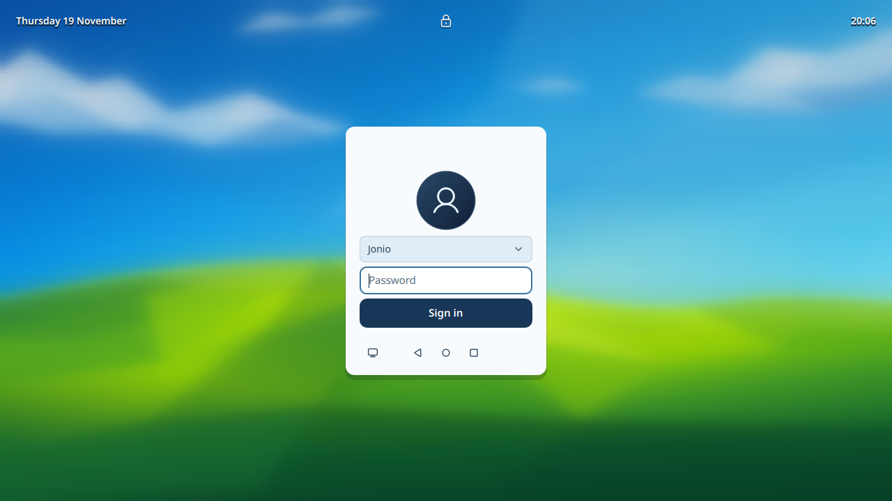
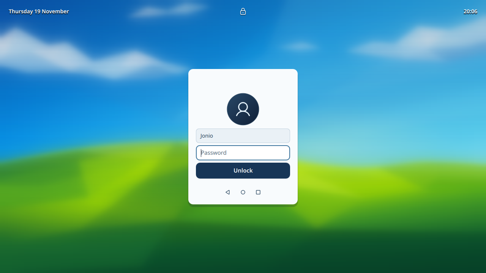

# Jonio Display Manager and Jonio Lockscreen

Matching themes for the SDDM login screen and the KDE Plasma lock screen on Wayland. Both share the Mattino wallpaper, user badge, and QML controls.

| [Jonio Display Manager](themes/jonio-display-manager/) | [Jonio Lockscreen](themes/jonio-lockscreen/) |
| --- | --- |
|  |  |

## Getting started

Jonio targets Debian 13, SDDM with the Qt 6 greeter, and Plasma Workspace 6.3.6. The [installation guide](docs/installation.md) covers setup, configuration checks, and restoring the original themes.

## Project layout

| Path | Contents |
| --- | --- |
| [`themes/jonio-display-manager/`](themes/jonio-display-manager/) | QML greeter and SDDM metadata |
| [`themes/jonio-lockscreen/`](themes/jonio-lockscreen/) | KScreenLocker entry point |
| [`themes/shared/`](themes/shared/) | Shared QML components, icons, and wallpaper |
| [`docs/`](docs/) | Setup guide and previews |
| [`install.sh`](install.sh) | Installation, verification, and removal |

[Preview the SDDM user menu](docs/previews/sddm-user-menu.png)
